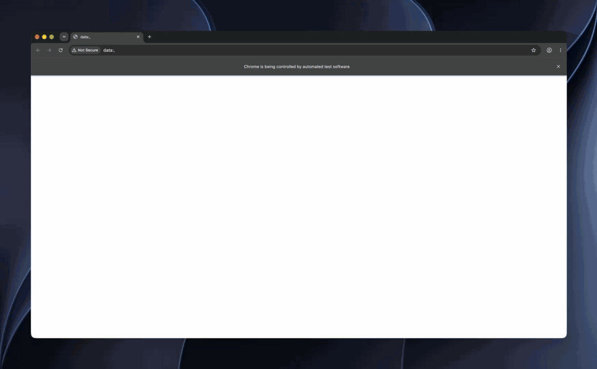
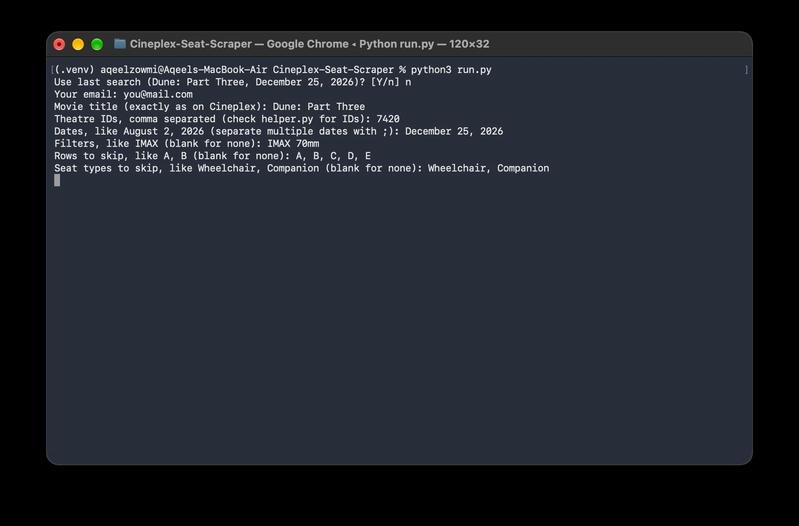
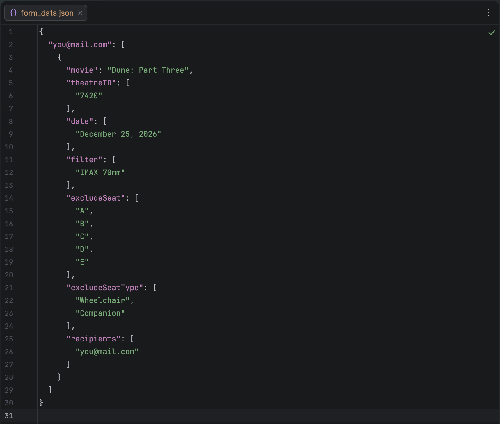
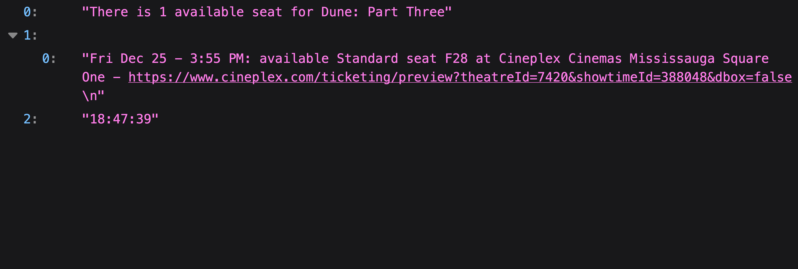
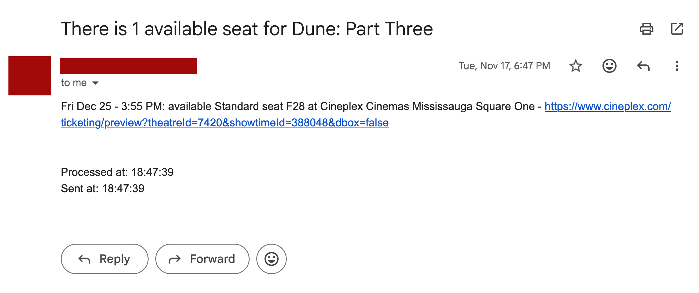

# Cineplex Seat Scraper

A Selenium-based scraper that checks Cineplex.com for available seats matching
a search (movie, theatre(s), date(s), and filters), and emails a notification
when matching seats are found.



## How it works

- `run.py` is the entry point. It asks what you're looking for (or offers to
  reuse your last search), saves your answers to `form_data.json`, and starts
  `runAll()`, which drives everything else.
- `cineplex.py` contains the scraper logic: it opens Cineplex.com in a
  headless Chrome window, selects the movie/date/theatre, applies filters,
  and inspects each showtime's seat map for available seats matching your
  criteria.
- On a schedule (every 5 seconds while running), it re-checks and writes the
  latest result to `available.json`.
- `emailSend.py` reads `available.json` and emails the result via Gmail SMTP.
- `helper.py` holds static reference data: theatre ID → name mapping, and
  seat type labels.

## Setup

1. Create a virtual environment and install dependencies:
   ```
   python3 -m venv .venv
   source .venv/bin/activate
   pip install selenium schedule python-dotenv
   ```
   Run `source .venv/bin/activate` again in each new terminal before
   running the scraper.
2. Make sure Chrome is installed. Selenium manages `chromedriver` itself
   (version 4.6+), so no separate driver download should be needed.
3. Create a `.env` file in this folder with your Gmail credentials:
   ```
   senderEmail=your_email@gmail.com
   GOOGLEPASS=your_gmail_app_password
   ```
   `GOOGLEPASS` must be a Gmail **App Password**, not your normal account
   password (Google requires this for SMTP login with 2FA enabled).
   `.env` is in `.gitignore`; never commit it.
4. Run it:
   ```
   python run.py
   ```

## Your search

`run.py` asks for each setting in the terminal:



| Question          | Example                     | Notes |
|-------------------|-----------------------------|-------|
| Email             | `you@gmail.com`             | Where notifications are sent. |
| Movie title       | `Dune: Part Three`          | Must exactly match the title as listed on Cineplex.com. |
| Theatre IDs       | `7420, 7408`                | Comma separated. See `theatresDict` in `helper.py` for the IDs. |
| Dates             | `December 25, 2026`         | Format: `Month D, YYYY`. Separate multiple dates with `;` (each date already contains a comma). |
| Filters           | `IMAX 70mm`                 | Cineplex format filters (e.g. `IMAX`, `VIP`, `Recliner`). Leave blank for none. |
| Rows to skip      | `A, B, C`                   | Seat row letters to exclude. Leave blank for none. |
| Seat types to skip| `Wheelchair, Companion`     | Seat categories to exclude (see `seatTypes` in `helper.py`). Leave blank for none. |

Your answers are saved to `form_data.json`:



Next time you run `python run.py`, it offers to reuse it:

```
Use last search (Dune: Part Three, December 25, 2026)? [Y/n]
```

Press Enter to start with the saved search, or type `n` to answer the
questions again. To start fresh, delete `form_data.json`. It's in
`.gitignore`, so your search stays on your machine.

## Output: `available.json`

Written after every scrape cycle, in the shape:
```json
["<status message>", "<details or list of seat matches>", "<HH:MM:SS timestamp>"]
```

For example, when one seat matches:



`emailSend.py` reads this file to compose the notification email. Like
`form_data.json`, it's in `.gitignore`.

## Notification email

When seats match, the first item in `available.json` becomes the subject and
the seat list becomes the body, followed by when the seats were found and
when the email was sent:



## Running headless

Chrome runs headless by default (`--headless=new` in `cineplex.py`'s Chrome
options) so no browser window pops up. If you need to visually debug a
selector or page-state issue, comment out the `--headless=new` line
temporarily so you can watch what the scraper is actually doing.

## Known quirks / gotchas

- **Movie titles must match exactly**, including punctuation, or the scraper
  reports "movie not found" and stops that cycle.
- **Dates must be written in full** (`December 25, 2026`). A date without
  the year (`December 25`) stops the run with a format error.
- **Dates must be within Cineplex's currently listed showtime window.** A
  date too far in the future (not yet posted) is indistinguishable from a
  typo; both show up as "date not found."
- **Theatre IDs must stay strings end-to-end.** `theatresDict` in `helper.py`
  is keyed by string IDs (`"7408"`, not `7408`). `run.py` keeps them as
  strings; if you edit `form_data.json` by hand, keep the quotes.
- The scraper catches `TimeoutException` and `MaxRetryError` around the main
  loop, but Selenium/network failures can raise other exception types
  (`SessionNotCreatedException`, `ReadTimeoutError`,
  `StaleElementReferenceException`, etc.). If the process exits unexpectedly,
  check the traceback for the exception type and consider adding it to the
  catch list, or wrap the scheduler loop in a broad `except Exception` if
  reliability matters more than surfacing every failure type immediately.
- If Chrome fails to launch at all (`SessionNotCreatedException: Chrome
  instance exited`), it's usually a stale `chromedriver` cache after a Chrome
  auto-update, or leftover zombie `chrome.exe`/`chromedriver.exe` processes
  from a previous crashed run — kill those and/or run
  `pip install -U selenium` to refresh Selenium Manager's driver cache.

## Project structure

```
.
├── run.py           # entry point: asks for your search, saves it, starts the scraper
├── cineplex.py      # scraper logic + scheduling loop
├── emailSend.py     # reads available.json, sends the notification email
├── helper.py        # theatre ID map, seat type labels
├── docs/images/     # README screenshots
├── form_data.json   # your saved search (created by run.py, not committed)
├── available.json   # latest scrape result (auto-generated, not committed)
└── .env             # senderEmail / GOOGLEPASS (not committed)
```
